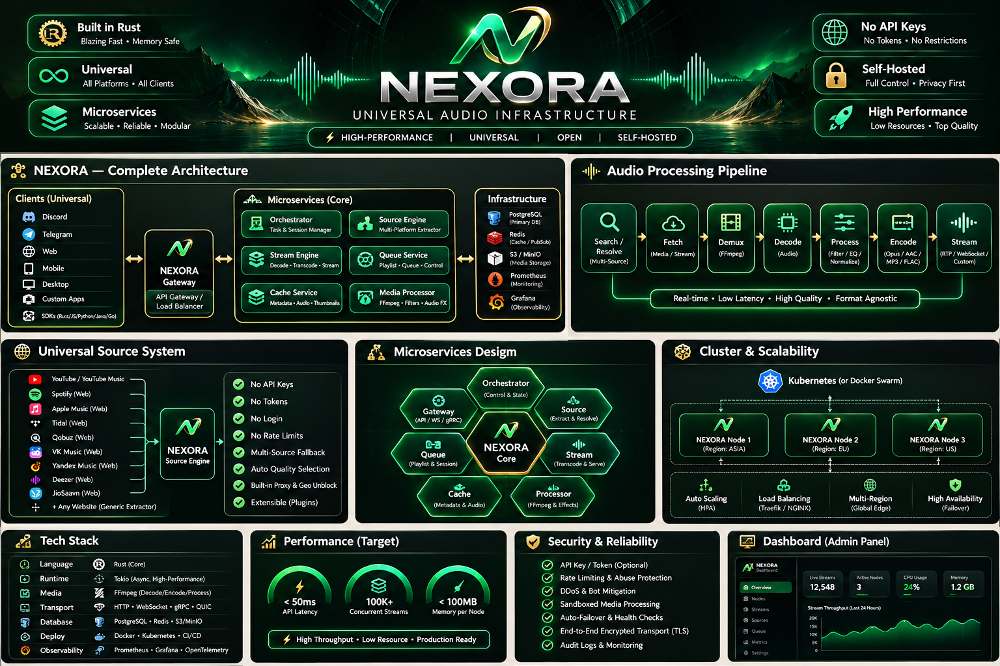
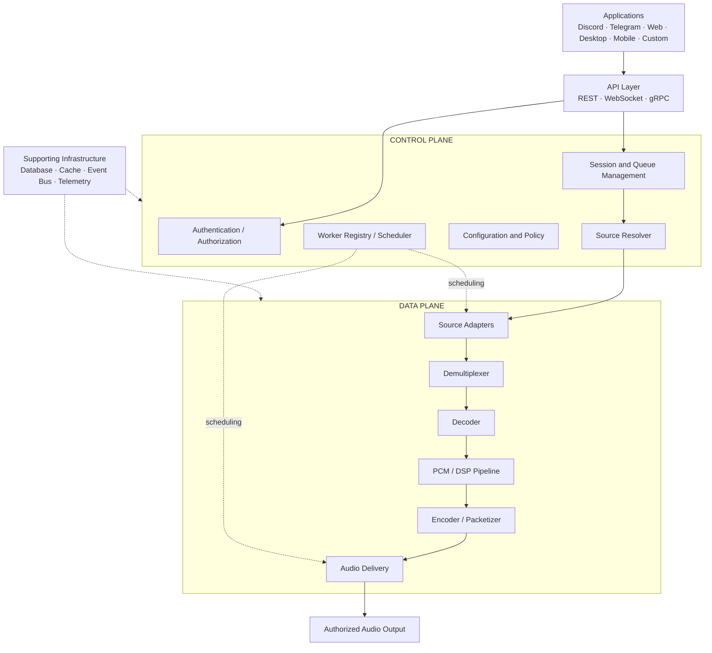
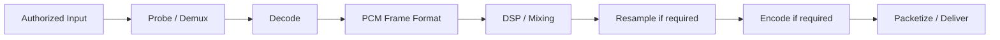
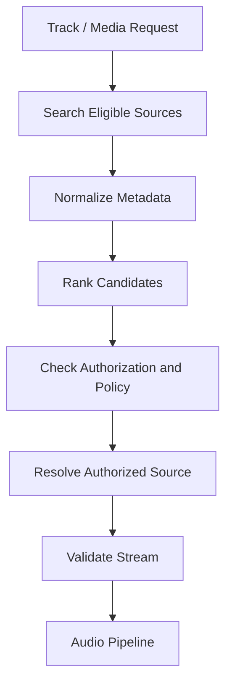

# NEXORA

## Universal Audio Infrastructure

**A Rust-first, modular audio engine and service platform for applications across programming-language ecosystems.**

<p align="center">
  
</p>

<p align="center">
  
  
  
  
</p>

> **One audio foundation. Multiple services. Any application ecosystem.**

NEXORA is an independent audio infrastructure written primarily in Rust. It aims to provide media ingestion, decoding, audio processing, transcoding, session orchestration, and audio delivery through documented interfaces that applications can consume from different programming languages.

NEXORA is built from scratch as an independent Rust alternative to hosted audio servers such as Lavalink. It is not a wrapper around Lavalink, not a JVM application, and not dependent on a third-party audio server. The practical goal is the same hosting experience: run one server, expose REST commands and WebSocket events, create per-application sessions, resolve media through pluggable source adapters, and deliver Opus audio to a connected client. NEXORA keeps its own Rust-native core and adds a Lavalink-compatible surface where it helps existing Discord bots migrate, while its universal `/api/v1` contract remains the long-term integration point for every application ecosystem.

NEXORA is intended for Discord and Telegram bots, web applications, desktop and mobile applications, games, and custom backend services. It is not designed to be limited to one chat platform or one programming language.

**Project status:** Milestones M0-M10 are implemented and verified: the Lavalink v4 REST/WebSocket surface and session lifecycle, event delivery, audio filters, Discord voice RTP framing, session resume, eight wired source adapters, deployment assets, and a real wasmi-based WASM plugin runtime with a sandboxed host interface. The honest compatibility statement is the [compatibility matrix](docs/COMPATIBILITY.md). Remaining work is production hardening, broader third-party client conformance, credentialed commercial sources, repeatable benchmark publication, and official SDKs (the `sdks/` tree was removed; `examples/bot_poc.py` calls `/api/v1` with the Python standard library only).

**Start here:** the [documentation map](docs/README.md) routes users, operators, contributors, and agents to the authoritative doc for each question. The sections below remain the long-form product and architecture reference.

---

## Table of Contents

- [1. Overview](#1-overview)
- [2. Vision and Scope](#2-vision-and-scope)
- [3. Architecture Principles](#3-architecture-principles)
- [4. System Architecture](#4-system-architecture)
- [5. Technology Stack](#5-technology-stack)
- [6. Audio Processing Design](#6-audio-processing-design)
- [7. Source Adapter Framework](#7-source-adapter-framework)
- [8. API Design](#8-api-design)
- [9. SDK Strategy](#9-sdk-strategy)
- [10. Storage and State Management](#10-storage-and-state-management)
- [11. Distributed Execution](#11-distributed-execution)
- [12. Performance Engineering](#12-performance-engineering)
- [13. Security and Provider Compliance](#13-security-and-provider-compliance)
- [14. Deployment Model](#14-deployment-model)
- [15. Observability](#15-observability)
- [16. Testing and Quality](#16-testing-and-quality)
- [17. Development Roadmap](#17-development-roadmap)
- [18. Proposed Repository Structure](#18-proposed-repository-structure)
- [19. Definition of Done](#19-definition-of-done)
- [20. Engineering Risks](#20-engineering-risks)
- [21. Initial Release Scope](#21-initial-release-scope)
- [22. Architecture Decision Records](#22-architecture-decision-records)
- [23. First Engineering Milestone](#23-first-engineering-milestone)
- [24. AI Agent Engineering Guide](#24-ai-agent-engineering-guide)
- [25. References](#25-references)
- [26. Project Philosophy](#26-project-philosophy)

---

## 1. Overview

NEXORA is intended to provide reusable audio infrastructure for applications that need to:

- Ingest supported local media and authorized network streams.
- Inspect media and identify available formats and codecs.
- Demultiplex and decode supported audio formats.
- Process PCM audio through a controlled pipeline.
- Resample and encode audio when required.
- Manage playback sessions and queues.
- Deliver audio through supported streaming transports.
- Register and manage source adapters.
- Run on one machine and evolve toward multi-node deployments.
- Expose stable APIs and language-specific client libraries.

### Initial architecture decisions

| Area | Direction |
|---|---|
| Product scope | Universal audio infrastructure |
| Primary implementation language | Rust |
| Initial execution model | Modular Rust workspace / single-node engine |
| Long-term deployment | Optional distributed services |
| Runtime | Tokio for asynchronous I/O and coordination |
| Public interfaces | REST and WebSocket; gRPC where appropriate |
| Internal service RPC | gRPC |
| Event distribution | NATS when distributed eventing is needed |
| Audio processing | Native Rust pipeline |
| Plugin direction | Versioned interfaces with sandboxed execution |
| Persistent metadata | PostgreSQL for server deployments |
| Lightweight mode | SQLite where appropriate |
| Performance approach | Measurement-driven CPU, memory, and latency optimization |

### Non-goals and compliance boundaries

NEXORA will not be designed to:

- Circumvent DRM or provider authentication.
- Extract protected media without authorization.
- Bypass provider rate limits, access controls, or usage restrictions.
- Promise access to every commercial music catalogue.
- Claim lossless output when the source is lossy.
- Operate as an unrestricted public media proxy.
- Depend on Discord-specific infrastructure as a core requirement.

Provider integrations must follow the provider's authorization, licensing, contractual, and technical requirements. Local media, open formats, and authorized streams are first-class use cases.

---

## 2. Vision and Scope

### Product vision

Build a reusable audio foundation that application developers can integrate without adopting a particular application framework or programming language.

### Target application ecosystems

- Discord bots and community applications.
- Telegram bots.
- Web applications and browser-based players.
- Desktop applications.
- Mobile applications.
- Games and interactive software.
- Custom backend services.
- Other clients that can use documented network protocols.

### Functional domains

1. **Media input:** local files, user-owned media, and authorized streams.
2. **Media handling:** probing, demultiplexing, decoding, and format negotiation.
3. **Audio processing:** PCM conversion, resampling, mixing, and optional DSP.
4. **Encoding:** output encoding when required by the destination.
5. **Playback control:** sessions, queues, state transitions, and events.
6. **Delivery:** streaming audio to authorized clients.
7. **Extensibility:** source adapters and processing extensions.
8. **Operations:** configuration, monitoring, deployment, and recovery.

---

## 3. Architecture Principles

NEXORA should follow these principles:

1. **Start simple, scale deliberately.** Build a working modular core before splitting components into independently deployed services.
2. **Keep the audio path efficient.** Avoid unnecessary network hops and data copies.
3. **Separate control from media data.** Session commands and metadata should not share the same processing path as high-volume audio frames.
4. **Bound resource usage.** Queues, buffers, sessions, and worker pools need explicit limits.
5. **Use stable contracts.** Public APIs and internal protocols must be versioned.
6. **Treat providers as adapters.** Provider-specific behavior must not leak into the core audio engine.
7. **Make failures explicit.** Use typed errors, timeouts, cancellation, and observable state transitions.
8. **Optimize from evidence.** Every performance claim must be supported by reproducible benchmarks.
9. **Use safe Rust by default.** Unsafe code requires a documented reason, a narrow boundary, and tests.
10. **Make compliance enforceable.** Authorization and provider restrictions are architectural requirements, not optional documentation.

---

## 4. System Architecture

### 4.1 Evolutionary architecture

The target is a distributed system, but the first implementation should not create a network boundary for every module.

**Stage 1 — Modular core:** One deployable Rust application with well-separated crates and bounded internal interfaces.

**Stage 2 — Service extraction:** Extract components only when independent scaling, fault isolation, deployment, or ownership provides a measurable benefit.

**Stage 3 — Distributed deployment:** Add worker registration, scheduling, event distribution, and multi-node operations.

This avoids paying microservice networking and operational costs before the workload requires them.

### 4.2 Control plane and data plane

The logical separation remains important even when both planes initially run in one process.

#### Control plane

Responsible for:

- API authentication and authorization.
- Application configuration.
- Session creation and lifecycle commands.
- Source selection and resolution requests.
- Worker discovery and scheduling in distributed mode.
- Quotas, policies, and administrative operations.

#### Data plane

Responsible for:

- Source ingestion.
- Demultiplexing and decoding.
- PCM frame processing.
- DSP and resampling.
- Encoding and packetization.
- Buffering and audio delivery.

**Performance rule:** Audio frames should not be routed through the public API gateway or serialized as ordinary JSON messages. Keep the media path close to the processing and delivery workers.

### 4.3 High-level logical architecture



### 4.4 Potential service boundaries

These are logical components, not a requirement to create all of them as separate services in the first release.

| Component | Responsibility | Initial priority |
|---|---|---|
| `nexora-api` | Public API and request validation | P0 |
| `nexora-auth` | Application identity and permissions | P0 |
| `nexora-session` | Playback lifecycle and queues | P0 |
| `nexora-resolver` | Source discovery and resolution | P0 |
| `nexora-source` | Source adapter execution | P0 |
| `nexora-audio` | Decode, PCM processing, and encode orchestration | P0 |
| `nexora-delivery` | Audio output transport | P0 |
| `nexora-registry` | Worker discovery in distributed mode | P1 |
| `nexora-cluster` | Scheduling and cluster coordination | P1 |
| `nexora-plugin-host` | Sandboxed extension execution | P1 |
| `nexora-observability` | Metrics, logs, and traces | P1 |
| `nexora-admin` | Administrative interface | P2 |

P0 means required for the first useful implementation. P1 and P2 are later capabilities, not commitments that they already exist.

### 4.5 Communication choices

| Communication | Intended use |
|---|---|
| HTTPS | Public REST API |
| WebSocket | Session and playback events |
| gRPC | Typed internal RPC and selected streaming interfaces |
| NATS | Asynchronous service events in distributed deployments |
| HTTP health endpoints | Liveness and readiness |
| Prometheus / OTLP | Metrics and telemetry |

Choose a transport based on measured requirements. Do not add NATS or gRPC between modules that can communicate efficiently through in-process interfaces.

---

## 5. Technology Stack

The following is a proposed stack. Crate versions and feature flags must be selected and tested together when implementation begins.

| Layer | Candidate technology | Intended use |
|---|---|---|
| Language | Rust | Core implementation |
| Async runtime | Tokio | Network I/O, timers, coordination |
| HTTP framework | Axum | REST API and service endpoints |
| RPC | Tonic | gRPC contracts and clients |
| Serialization | Serde | Configuration and structured payloads |
| Media framework | Symphonia | Supported demuxing and decoding |
| Resampling | Rubato | Sample-rate conversion |
| HTTP client | Reqwest | Authorized source connections |
| Cache | Moka | In-process cache |
| Database | PostgreSQL | Persistent server metadata |
| Local database | SQLite | Lightweight single-node deployments |
| Event bus | NATS | Distributed event delivery |
| Plugin runtime | Wasmtime / WASI | Potential sandboxed plugin execution |
| Logging | `tracing` | Structured diagnostics |
| Telemetry | OpenTelemetry | Distributed traces and metrics |
| Benchmarking | Criterion | Repeatable microbenchmarks |

### Runtime strategy

- Use Tokio for asynchronous I/O, timers, and service coordination.
- Run CPU-heavy decoding, encoding, and DSP on dedicated bounded worker pools.
- Use bounded channels between pipeline stages.
- Reuse frame buffers where practical.
- Apply backpressure instead of allowing unlimited queue growth.
- Use SIMD only when supported by the target and proven beneficial by benchmarks.
- Keep blocking file and CPU operations off asynchronous executor threads.

Codec support depends on selected library features, build configuration, platform, and licensing considerations. The project must publish a tested format/codec compatibility matrix rather than assuming every format is supported.

---

## 6. Audio Processing Design

### 6.1 Processing pipeline



### 6.2 Internal audio representation

The internal representation should define, at minimum:

- Sample format and numeric representation.
- Sample rate.
- Channel count and channel layout.
- Frame sequence or presentation timestamp.
- Number of valid samples.
- Buffer ownership and lifetime.
- Discontinuity and end-of-stream semantics.

A conceptual interface could look like:

```rust
pub struct AudioFormat {
    pub sample_rate: u32,
    pub channels: u16,
    pub sample_format: SampleFormat,
    pub channel_layout: ChannelLayout,
}

pub struct AudioFrame {
    pub sequence: u64,
    pub timestamp_samples: u64,
    pub format: AudioFormat,
    pub samples: AudioBuffer,
}

pub enum SampleFormat {
    F32,
    I16,
}

pub enum AudioBuffer {
    InterleavedF32(Vec<f32>),
    InterleavedI16(Vec<i16>),
}
```

This is an illustrative design, not a finalized public API. A production implementation should consider reusable pooled buffers, planar versus interleaved layouts, channel mapping, alignment, and ownership without forcing a heap allocation for every frame.

### 6.3 Processing stages

1. **Input validation:** Validate source configuration and authorization.
2. **Probing:** Determine container, stream metadata, codec, and parameters.
3. **Demultiplexing:** Extract the relevant audio packets.
4. **Decoding:** Convert encoded packets to the internal PCM representation.
5. **DSP:** Apply only requested and supported processing.
6. **Resampling:** Convert sample rate when the output requires it.
7. **Encoding:** Encode only when passthrough is not compatible.
8. **Delivery:** Send output through the selected transport with bounded buffering.

### 6.4 Passthrough and transcoding

**Passthrough** may be used when the source codec, packetization, and destination requirements are compatible and no processing step requires PCM.

**Transcoding** is required when the output format differs, processing is requested, or the destination cannot consume the source representation.

Avoid unnecessary transcoding. It consumes CPU and may reduce audio quality. The engine must clearly report the actual output format and must not describe lossy-source output as lossless.

---

## 7. Source Adapter Framework

The source framework must be independent of the core audio pipeline.

### 7.1 Source categories

| Category | Examples | Requirements |
|---|---|---|
| Local media | User-provided WAV, FLAC, MP3, or other supported files | File access permission |
| Public radio | Publicly available radio stream | Follow stream terms and access rules |
| Direct HTTP audio | Authorized audio URL | URL validation and endpoint authorization |
| User-owned media | Uploaded or application-owned assets | Application authorization |
| Provider integration | Commercial media platform | Provider-approved access and licensing |
| Custom adapter | Organization-specific source | Explicit capability and permission model |

### 7.2 Adapter responsibilities

A source adapter may provide:

- Source identity and version.
- Supported capabilities.
- Search, where permitted.
- Metadata lookup.
- Authorized stream resolution.
- Health status.
- Cancellation and cleanup.
- Typed error mapping.

The production contract must include timeout handling, cancellation, authorization context, stream lifetime, resource limits, and explicit capability negotiation.

### 7.3 Resolver flow



Candidate ranking may consider title similarity, artist match, duration, metadata quality, source availability, user preferences, and output compatibility. Ranking must never override authorization or provider restrictions.

### 7.4 Plugin direction

Third-party adapters may eventually run in a sandboxed runtime.

Expected safeguards:

- Versioned plugin interface.
- Manifest and capability declarations.
- Explicit network and filesystem permissions.
- Resource and execution-time limits.
- Secrets provided only through scoped interfaces.
- Compatibility validation.
- Publisher trust or signature verification where applicable.
- Revocation and auditability.

WASM/Wasmtime is a candidate, not a completed feature. A sandbox does not automatically make untrusted code safe; host capabilities must be deliberately restricted.

---

## 8. API Design

The API is the primary integration contract. SDKs should wrap the same contract rather than reimplementing playback behavior independently.

### 8.1 Versioning convention

Use one consistent base path:

`/api/v1`

All REST endpoints below use this prefix.

### 8.2 Initial endpoint proposal

| Endpoint | Method | Purpose |
|---|---|---|
| `/api/v1/health` | GET | Health status |
| `/api/v1/info` | GET | Engine and API information |
| `/api/v1/sources` | GET | Available source capabilities |
| `/api/v1/search` | POST | Search eligible sources |
| `/api/v1/resolve` | POST | Resolve an authorized media reference |
| `/api/v1/sessions` | POST | Create a session |
| `/api/v1/sessions/{session_id}` | GET | Read session state |
| `/api/v1/sessions/{session_id}/play` | POST | Start or change playback |
| `/api/v1/sessions/{session_id}/pause` | POST | Pause |
| `/api/v1/sessions/{session_id}/resume` | POST | Resume |
| `/api/v1/sessions/{session_id}/stop` | POST | Stop |
| `/api/v1/sessions/{session_id}/seek` | POST | Seek, when supported |
| `/api/v1/sessions/{session_id}/volume` | PUT | Set output volume |
| `/api/v1/sessions/{session_id}/filters` | PUT | Configure supported filters |
| `/api/v1/sessions/{session_id}/queue` | GET | Read queue |
| `/api/v1/sessions/{session_id}/stream` | GET | Access authorized audio output |
| `/api/v1/metrics` | GET | Metrics endpoint, if enabled and protected appropriately |

These endpoints are a design proposal. Request schemas, response schemas, error codes, authentication scopes, and compatibility rules must be specified in OpenAPI before the API is considered stable.

### 8.3 Example: create a session

```http
POST /api/v1/sessions
Content-Type: application/json
Authorization: Bearer <application-token>
```

```json
{
  "client": {
    "application": "example-client",
    "version": "1.0.0"
  },
  "output": {
    "codec": "opus",
    "sample_rate": 48000,
    "channels": 2
  }
}
```

Illustrative response:

```json
{
  "session_id": "nx_session_example",
  "status": "created",
  "engine": "nexora",
  "api_version": "v1"
}
```

### 8.4 Example: search

```http
POST /api/v1/search
Content-Type: application/json
Authorization: Bearer <application-token>
```

```json
{
  "query": "example audio",
  "sources": ["local", "radio"],
  "limit": 10
}
```

The server must only search sources enabled for the application and permitted by the relevant source policy.

### 8.5 WebSocket events

Proposed endpoint:

`/ws/v1/sessions/{session_id}`

Potential event names:

- `session.created`
- `session.ready`
- `track.started`
- `track.ended`
- `track.failed`
- `playback.paused`
- `playback.resumed`
- `playback.stopped`
- `queue.updated`
- `source.unavailable`
- `engine.warning`

Each event should include an event ID, schema version, timestamp, session ID, event type, payload, and correlation ID.

Clients must be able to reconnect and retrieve current session state. They should not depend exclusively on transient WebSocket events.

---

## 9. SDK Strategy

Official SDKs should be thin, typed clients over the same documented API.

| Language | Proposed package identifier |
|---|---|
| Python | `nexora` (proposed) |
| Node.js / TypeScript | `@nexora/sdk` (proposed) |
| Java | `dev.nexora:sdk` (proposed) |
| Go | `github.com/nexora/sdk-go` (proposed) |
| C# | `Nexora.SDK` (proposed) |
| PHP | `nexora/sdk` (proposed) |
| Rust | `nexora-client` (proposed) |

These are naming proposals only. They are not claims that packages have been published or registered.

### SDK capabilities

- Authentication and token configuration.
- Session creation and lifecycle commands.
- Search and source resolution.
- Queue management.
- Event subscriptions.
- Reconnection and state recovery.
- Typed request and response models.
- Consistent error handling.
- Supported audio output access.

Publish OpenAPI and protobuf contracts so developers can generate clients for languages that do not yet have an official SDK.

---

## 10. Storage and State Management

Storage responsibilities must remain distinct. Audio packets should not be stored as ordinary database rows.

| Technology | Intended responsibility | Status |
|---|---|---|
| PostgreSQL | Persistent application and session metadata | Proposed server database |
| SQLite | Lightweight single-node metadata storage | Optional deployment mode |
| Moka | In-process cache | Optional |
| Redis | Shared ephemeral state when required | Optional |
| NATS JetStream | Durable event delivery when required | Optional distributed component |
| S3-compatible storage | User-owned media and optional assets | Optional |

Redis, NATS, and object storage are not required dependencies for the first standalone engine.

### Data model candidates

- `applications`
- `api_credentials`
- `users` (only if user accounts are part of the chosen product scope)
- `sessions`
- `session_tracks`
- `queues`
- `track_metadata`
- `source_registry`
- `source_health`
- `plugin_registry`
- `plugin_versions`
- `worker_registry`
- `cluster_nodes`
- `audit_events`

### State ownership

- Persistent metadata belongs in the configured database.
- Active playback state should be held in memory by the session owner.
- State may be checkpointed when recovery requirements justify it.
- Audio frames belong in bounded in-memory pipeline buffers, not database tables.
- Cache keys must include source identity, authorization scope, and relevant format parameters.
- Private or restricted media cache entries must not be shared across unrelated applications.

---

## 11. Distributed Execution

Distributed execution is a later stage, not a prerequisite for the first usable release.

### 11.1 Components

- **Coordinator:** assigns work.
- **Registry:** tracks worker identity, version, health, and capabilities.
- **Scheduler:** chooses an eligible worker.
- **Audio worker:** performs supported processing.
- **Delivery worker:** manages output transport.
- **Health monitor:** detects unavailable workers.
- **Event transport:** distributes lifecycle events.

### 11.2 Worker capability model

A worker registration should describe its identity, version, capabilities, and measured capacity. Example values must be treated as illustrative:

```json
{
  "worker_id": "worker-example",
  "service": "audio-worker",
  "version": "0.1.0",
  "capabilities": [
    "decode",
    "resample",
    "opus_encode"
  ],
  "resources": {
    "cpu_capacity_units": 100,
    "active_jobs": 0
  }
}
```

Capacity units must be calibrated through workload benchmarks. They must not be inferred from a single CPU percentage.

### 11.3 Scheduling signals

A scheduler may consider:

- Available CPU and memory headroom.
- Active workload and queue depth.
- Supported codecs and processing capabilities.
- Network proximity.
- Worker health.
- Session affinity.
- Resource quotas and tenant policy.

Avoid moving an active stream between workers unless state transfer and continuity are explicitly implemented and tested.

### 11.4 Reliability mechanisms

- Heartbeats and health checks.
- Graceful shutdown and task cancellation.
- Bounded retries with backoff.
- Circuit breakers where appropriate.
- Idempotent control commands.
- Duplicate-event protection.
- Session recovery strategy.
- Dead-letter handling for durable asynchronous jobs.

---

## 12. Performance Engineering

NEXORA should optimize for measured workload efficiency rather than marketing claims.

### 12.1 Initial engineering objectives

These are proposed targets for investigation, not verified benchmarks, service-level agreements, or guarantees.

| Metric | Initial objective |
|---|---|
| API command latency | Investigate p95 below 50 ms under a defined local test workload |
| Internal RPC latency | Investigate p95 below 10 ms under a defined local test workload |
| Session creation | Investigate p95 below 100 ms under a defined test workload |
| Queue growth | No unbounded queue growth |
| Memory use | Bounded and measured per active session |
| Availability | Define an SLO only after deployment and operational data exist |
| Audio processing overhead | Measure per codec, frame size, and processing configuration |

Network latency, provider response time, and NEXORA processing time must be measured separately.

### 12.2 Memory practices

1. Reuse buffers where safe.
2. Bound channel capacities.
3. Avoid unnecessary PCM copies.
4. Stream media instead of downloading complete tracks when appropriate.
5. Release decoder and source resources promptly.
6. Apply per-session and per-worker memory budgets.
7. Evict cache entries according to explicit policies.
8. Prevent uncontrolled task creation.
9. Handle slow consumers with backpressure.
10. Degrade gracefully when resource limits are reached.

### 12.3 CPU practices

- Use release builds for performance testing.
- Profile before optimizing.
- Use dedicated processing pools for CPU-heavy work.
- Prefer codec passthrough when compatible.
- Evaluate SIMD only with reproducible comparisons.
- Measure CPU cost per active stream and per codec.
- Avoid unsafe Rust unless a benchmark and safety review justify it.

### 12.4 Benchmark suite

Benchmark at least:

- WAV and other supported local format decoding.
- FLAC and MP3 decoding where enabled.
- Opus encoding where enabled.
- PCM resampling.
- DSP operations.
- Concurrent sessions.
- Memory per session.
- Startup and shutdown time.
- Cache hit ratio.
- Network throughput.
- CPU consumption per active stream.
- Backpressure and slow-client behavior.

Comparisons must use identical inputs, codec settings, hardware, build profiles, and workload definitions.

---

## 13. Security and Provider Compliance

Security is part of the architecture.

### 13.1 Authentication and authorization

- Application-scoped credentials.
- Least-privilege permissions.
- Credential rotation and revocation.
- Token expiration.
- Secure secret storage.
- Per-application quotas.
- Audit events for sensitive operations.

### 13.2 Network security

- TLS for external connections.
- mTLS for internal links where the threat model requires it.
- Request validation and body-size limits.
- Rate limiting and abuse controls.
- SSRF protection for user-supplied URLs.
- Redirect validation.
- Private-network and metadata-address blocking.
- Egress policies.
- No unrestricted open-proxy behavior.

### 13.3 Plugin security

- Sandboxed execution.
- Explicit filesystem and network capabilities.
- CPU, memory, and execution-time limits.
- Versioned host interfaces.
- Secrets available only through scoped host APIs.
- Plugin revocation and auditability.

### 13.4 Media and provider compliance

- Support locally owned media and authorized streams.
- Use documented provider interfaces where applicable.
- Respect provider licensing, authentication, rate limits, and usage restrictions.
- Do not implement DRM circumvention or unauthorized extraction.
- Keep provider credentials isolated from the core engine.
- Do not promise universal access to commercial catalogues.

---

## 14. Deployment Model

NEXORA should evolve through deployment profiles.

### Profile A — Local development

One process with local configuration and test media. Intended for development and automated tests.

### Profile B — Single-node self-hosting

A standalone application with optional database support. Docker packaging may be added when the runtime is stable.

### Profile C — Multi-process / multi-node

Independent workers and services with explicit service discovery, scheduling, and operational monitoring.

### Profile D — Kubernetes

Consider Kubernetes only when deployment scale and operational requirements justify its complexity.

### Example configuration

The following is illustrative. It must not be treated as a finalized configuration schema until validated by the implementation.

```toml
[server]
host = "127.0.0.1"
port = 8080

[engine]
max_sessions = 100
buffer_duration_ms = 2000

[audio]
default_codec = "opus"
sample_rate = 48000
channels = 2

[cache]
enabled = true
max_memory_mb = 128

[cluster]
enabled = false

[plugins]
enabled = false
```

Production deployments should use environment-specific configuration, validated limits, and a secret manager or equivalent secure secret injection. Do not commit real credentials to the repository.

---

## 15. Observability

The system should expose enough telemetry to diagnose audio quality, resource pressure, and service failures.

### Proposed metrics

| Metric | Meaning |
|---|---|
| `nexora_active_sessions` | Current active sessions |
| `nexora_audio_frames_total` | Frames processed |
| `nexora_decode_errors_total` | Decoder failures |
| `nexora_source_errors_total` | Source adapter failures |
| `nexora_worker_cpu_usage` | Worker CPU utilization |
| `nexora_worker_memory_bytes` | Worker memory usage |
| `nexora_buffer_underruns_total` | Buffer underruns |
| `nexora_api_latency_seconds` | API request latency |
| `nexora_stream_bytes_total` | Delivered bytes |
| `nexora_cache_hits_total` | Cache hits |

Metric names and labels must be reviewed to avoid high-cardinality dimensions such as raw URLs, tokens, or arbitrary user input.

### Logs and traces

- Use structured logs with correlation IDs.
- Never log credentials, authorization headers, or private media URLs containing secrets.
- Trace session commands across service boundaries.
- Record source and codec errors with safe diagnostic context.
- Define retention and access policies for operational data.

### Future administrative dashboard

Potential views include service health, active sessions, worker availability, CPU and memory, audio processing latency, source health, bandwidth, cache statistics, and error rates.

---

## 16. Testing and Quality

Testing must cover correctness, compatibility, performance, security, and recovery.

| Test category | Required validation |
|---|---|
| Unit | Individual modules and data transformations |
| Integration | API, storage, and service boundaries |
| Audio correctness | Decode, resample, encode, and output behavior |
| Compatibility | Supported container and codec matrix |
| Load | Concurrent sessions and throughput |
| Stress | Resource exhaustion and recovery |
| Failure | Source and worker disconnection |
| Security | API authorization, SSRF, and plugin isolation |
| Regression | Existing supported behavior remains intact |

### Audio correctness checks

- Sample-rate correctness.
- Channel-layout correctness.
- Clipping and overflow behavior.
- Timestamp continuity.
- Gapless playback where supported.
- Resampling quality.
- Codec compatibility.
- Buffer underrun behavior.
- Cancellation and end-of-stream handling.

### Continuous integration

Once the Rust workspace and relevant tools exist, CI should run applicable checks such as:

```bash
cargo fmt --all -- --check
cargo clippy --workspace --all-targets --all-features -- -D warnings
cargo test --workspace --all-features
cargo audit
cargo deny check
```

`cargo audit` and `cargo deny` require the corresponding tools and configuration. The CI pipeline should install or provision them explicitly. Do not add `--all-features` blindly if mutually exclusive features exist; define the supported feature matrix.

Additional checks may include:

- Dependency license policy.
- Parser and decoder fuzzing.
- API contract validation.
- Container build tests.
- Cross-platform compilation.
- Performance regression tests.
- Documentation build and link checks.

---

## 17. Development Roadmap

Build and validate each stage before expanding scope.

### Phase 1 — Workspace foundation

- Rust workspace and crate boundaries.
- Shared types and error model.
- Configuration validation.
- Structured logging.
- Basic CI.
- Minimal runnable binary.

**Exit condition:** Workspace builds, tests, and runs reproducibly.

### Phase 2 — Standalone audio core

- Audio format and frame abstractions.
- Local media input.
- Demultiplexing and decoding.
- PCM processing.
- Buffering and backpressure.
- Resampling.
- Output encoding.

**Exit condition:** Supported input can be processed into a verified output with benchmark results.

### Phase 3 — Source framework

- Source adapter contract.
- Local media adapter.
- Authorized HTTP stream adapter.
- Public radio adapter where permitted.
- Source capability and health reporting.

**Exit condition:** Adapters can be registered and used without changing the core pipeline.

### Phase 4 — Session and API layer

- Session lifecycle.
- Queue model.
- REST API.
- WebSocket events.
- Authentication and authorization.

**Exit condition:** A client can create a session, control playback, and recover state.

### Phase 5 — First SDKs

- Python client.
- Node.js / TypeScript client.
- OpenAPI and protobuf contracts.
- Runnable examples.

**Exit condition:** Both clients pass integration tests against the same server contract.

### Phase 6 — Operational maturity

- Docker packaging.
- Metrics and traces.
- Configuration and deployment documentation.
- Security review.
- Load and failure testing.

**Exit condition:** Reproducible single-node deployment with documented operational behavior.

### Phase 7 — Distributed execution

- Worker registry.
- Scheduling.
- Event bus.
- Multi-node sessions.
- Recovery and fault isolation.

**Exit condition:** Multi-node behavior is tested under worker failure and load.

### Phase 8 — Plugin ecosystem and additional SDKs

- Sandboxed plugin host.
- Plugin manifest and SDK.
- Java, Go, C#, PHP, and Rust clients as demand warrants.
- Compatibility and security review.

**Exit condition:** Third-party extensions run through a documented, constrained interface.

---

## 18. Proposed Repository Structure

This is a target structure. Create directories when the corresponding implementation phase begins; do not add empty placeholder services just to match the diagram.

```text
NEXORA/
├── Cargo.toml / Cargo.lock       # Rust workspace, pinned dependencies
├── crates/                       # Reusable Rust libraries
│   ├── nexora-error              # shared error types
│   ├── nexora-common             # shared foundation
│   ├── nexora-audio-types        # audio frame/format abstractions
│   ├── nexora-audio-decode       # demux/decode (Symphonia)
│   ├── nexora-audio-codec        # encode/packetize (Opus)
│   ├── nexora-audio-pipeline     # PCM processing pipeline
│   ├── nexora-source-api         # AudioSource, auth, track contracts
│   ├── nexora-source-framework   # adapter registry, ranking, local/radio/HTTP
│   ├── nexora-session            # sessions, queue, playback control, Opus fanout
│   ├── nexora-grpc               # tonic adapter over SessionManager
│   ├── nexora-cluster            # cluster primitives
│   ├── nexora-plugin-api         # versioned plugin interfaces
│   ├── nexora-protocol           # versioned DTOs and event envelope
│   ├── nexora-config             # shared configuration
│   ├── nexora-telemetry          # tracing/metrics
│   └── nexora-service            # service runtime
├── services/                     # Deployable binaries
│   ├── nexora-server             # REST, event WS, audio WS, gRPC listener
│   ├── nexora-gateway            # skeleton control-plane service
│   └── nexora-audio-engine       # standalone batch transcode CLI
├── sdks/                         # (removed; no official SDK ships today)
├── deploy/                       # Docker Compose, env example, monitoring
├── examples/                     # Runnable proof-of-concept clients
├── assets/                       # Images and infographics
├── docs/                         # This documentation tree
└── README.md
```

### Repository rules

- Shared crates must not create circular dependencies.
- Public contracts must be versioned.
- Each independently deployed application must have its own build and deployment instructions.
- Avoid creating a microservice until there is a concrete operational reason.
- Changes to shared interfaces must include migration notes and tests.
- Keep generated files and build artifacts out of source control unless intentionally required.

---

## 19. Definition of Done

A feature is complete only when its implementation, tests, documentation, and operational behavior agree.

| Area | Acceptance criteria |
|---|---|
| Audio engine | Processes documented formats correctly |
| Source system | Adapters register through a stable contract |
| API | Versioned, authenticated, and documented |
| SDKs | Pass integration tests against the API |
| Sessions | Lifecycle and recovery behavior are tested |
| Audio output | Stable under documented test workloads |
| Resource control | Queues and buffers are bounded |
| Distributed mode | Worker discovery and scheduling are tested, if implemented |
| Security | Authorization and network restrictions are tested |
| Plugins | Sandboxing and permissions are validated, if implemented |
| Monitoring | Metrics, logs, and traces are available |
| Documentation | Setup, API, architecture, and operations are current |
| CI | Required checks run automatically |

Do not describe NEXORA as production-ready solely because a server starts or a sample file plays.

---

## 20. Engineering Risks

| Risk | Mitigation |
|---|---|
| Premature microservices | Start with modular core; extract services based on evidence |
| Network overhead in audio path | Keep media processing local to workers |
| Unbounded memory use | Bounded queues, buffer pools, and quotas |
| Codec incompatibility | Publish and test a compatibility matrix |
| Source instability | Adapter isolation, timeouts, health checks |
| Cluster complexity | Defer distributed execution until needed |
| Plugin vulnerabilities | Sandboxing and least-privilege capabilities |
| API incompatibility | Versioned schemas and contract tests |
| Audio quality degradation | Objective signal and playback tests |
| Provider restrictions | Authorized integrations and compliance review |
| Dependency vulnerabilities | Auditing, updates, and dependency policy |
| Observability overhead | Measure telemetry cost and control cardinality |

---

## 21. Initial Release Scope

### NEXORA 0.1.0 — Standalone Audio Foundation

The first release should focus on a small, verifiable feature set:

- Rust workspace and runnable server or engine binary.
- Core audio frame and format abstractions.
- Local media input.
- Decoder support for explicitly documented formats.
- PCM processing pipeline.
- Bounded buffering and cancellation.
- Resampling where required.
- Opus output if the selected encoder integration is validated.
- Basic session lifecycle.
- Minimal REST API.
- Basic WebSocket events if session events are part of the first client workflow.
- Python and Node.js clients only after the API contract stabilizes.
- Reproducible tests and benchmarks.
- Basic metrics and operational documentation.

### Explicitly deferred from 0.1.0

- Kubernetes orchestration.
- Large-scale distributed scheduling.
- Plugin marketplace.
- Every commercial music provider.
- Every language SDK.
- Claims of production-grade high availability.
- Unverified performance guarantees.

The 0.1.0 release should prove a reliable audio foundation before adding a large service ecosystem.

---

## 22. Architecture Decision Records

The following are proposed initial decisions. Each should become an individual ADR when the repository begins recording accepted decisions and their rationale.

| ADR | Proposed decision |
|---|---|
| ADR-001 | Rust as the primary implementation language |
| ADR-002 | Modular core before service extraction |
| ADR-003 | Logical separation of control and data planes |
| ADR-004 | Tokio for asynchronous I/O |
| ADR-005 | gRPC for selected internal RPC contracts |
| ADR-006 | REST and WebSocket for public control APIs |
| ADR-007 | Native audio processing pipeline |
| ADR-008 | Independent source adapter interfaces |
| ADR-009 | Sandboxed plugin runtime after core maturity |
| ADR-010 | PostgreSQL for server metadata |
| ADR-011 | NATS for distributed events when required |
| ADR-012 | Single-node deployment before cluster deployment |
| ADR-013 | OpenAPI and protobuf for machine-readable contracts |
| ADR-014 | Benchmark-driven performance optimization |

An ADR should include context, decision, alternatives, consequences, and status. A proposed decision must not be presented as accepted until the project maintainers approve it.

---

## 23. First Engineering Milestone

### NEXORA Core 0.1 — Standalone Rust Audio Engine

The first milestone validates the audio data path before introducing distributed infrastructure.

#### Initial checklist

- [ ] Cargo workspace and build configuration.
- [ ] Core error and configuration types.
- [ ] Audio format abstraction.
- [ ] Audio frame and buffer abstraction.
- [ ] Source adapter interface.
- [ ] Local media input.
- [ ] Decoder integration.
- [ ] PCM processing pipeline.
- [ ] Bounded buffering and cancellation.
- [ ] Resampling.
- [ ] Output encoder integration.
- [ ] Unit and integration tests.
- [ ] Reproducible benchmark suite.
- [ ] Basic operational documentation.

**Success condition:** The engine accepts documented, supported input, processes it, and produces verified output while reporting reproducible CPU, memory, and latency measurements.

---

## 24. AI Agent Engineering Guide

AI coding agents must treat the repository as an engineering project, not as permission to rewrite the architecture without review.

Before changing code, an agent should:

1. Read the repository instructions and relevant documentation.
2. Inspect the actual directory structure, Cargo workspace, and existing implementation.
3. Check Git status and avoid overwriting unrelated user changes.
4. Identify what is implemented, partially implemented, and only planned.
5. Report architectural conflicts and missing prerequisites.
6. Propose a small, testable implementation plan.
7. Wait for approval before major architectural changes or destructive operations.
8. Implement incrementally and run the relevant tests.
9. Update documentation to match actual behavior.
10. Never invent successful test results, benchmarks, integrations, or completed features.

**Master instructions:** [MASTER_AI_INSTRUCTIONS.md](docs/MASTER_AI_INSTRUCTIONS.md)

The linked file must exist at that exact repository path. If it is stored elsewhere, update this link to match its actual location.

Compatible coding environments may include Claude Code, OpenAI Codex, OpenCode, Cursor, and other tools that can read repository instructions. Compatibility depends on each tool's instruction-file conventions and configuration.

---

## 25. References

These are primary project references for evaluating the proposed stack. Check current documentation and compatibility before selecting versions.

1. [Tokio — Asynchronous Rust Runtime](https://tokio.rs/)
2. [Symphonia — Rust Media Framework](https://github.com/pdeljanov/Symphonia)
3. [Rubato — Audio Resampling](https://github.com/HEnquist/rubato)
4. [Axum — HTTP Framework](https://github.com/tokio-rs/axum)
5. [Tonic — gRPC for Rust](https://github.com/hyperium/tonic)
6. [OpenTelemetry Rust](https://opentelemetry.io/docs/languages/rust/)
7. [NATS](https://nats.io/)
8. [WebAssembly](https://webassembly.org/)
9. [WASI](https://wasi.dev/)
10. [Wasmtime](https://wasmtime.dev/)

---

## 26. Project Philosophy

### Mission

Build a universal, high-performance audio foundation that lets developers integrate audio processing and streaming into their applications without being locked into one programming language or application framework.

### Engineering values

- Rust-first implementation.
- Measured resource efficiency.
- Audio correctness and fidelity.
- Open, documented integration contracts.
- Modular and maintainable design.
- Deliberate distributed scalability.
- Provider-independent core.
- Security and compliance by design.
- Honest project status and reproducible results.

> **NEXORA — One Engine. Every Application.**

## Community

- [Security policy](SECURITY.md) — report vulnerabilities privately; do not open public issues for them
- [Code of conduct](CODE_OF_CONDUCT.md)
- [Issue templates](.github/ISSUE_TEMPLATE) and [pull request template](.github/PULL_REQUEST_TEMPLATE.md)
- Documentation site — built from this `docs/` tree with mdBook (`book.toml`; run `mdbook build` to render locally)
- The [compatibility matrix](docs/COMPATIBILITY.md) is the project's honest compatibility statement

---

## Project Status

At `b4346a2` the workspace passes `cargo fmt --all -- --check`, `cargo clippy --workspace --all-targets -- -D warnings`, and `cargo test --workspace` (370 tests, 0 failures); CI run `46001329810` is green. See `docs/PROJECT_STATUS.md` for the current milestone and `docs/ARCHITECTURE.md` for the implemented structure.

| Area | Current status |
|---|---|
| Product vision | Defined: from-scratch Rust alternative with a Lavalink-like hosted server experience |
| Target architecture | Implemented: protocol, session, source, pipeline, server and plugin crates |
| Rust technology stack | Pinned in `Cargo.toml` and compiled in CI on Linux and Windows |
| Audio engine | Implemented: decode, resample, filters, PCM/Opus output, 20 ms packets |
| Source adapters | Implemented: registry, ranking, SSRF validation, and eight wired adapters (archive, Bandcamp, SoundCloud, Apple Music, Deezer, Tidal, Spotify, YouTube) |
| REST / WebSocket API | Implemented: `/api/v1` + Lavalink-v4-compatible routes under `/nexora/*` + session resume + native audio WebSocket |
| Internal gRPC | Implemented (Phase 4b): `nexora.v1.SessionService` |
| Voice transport | Implemented: one UDP socket per player, RTP framing and AES-128-CTR payloads; no voice gateway (client owns it) |
| SDKs | Not shipped: the `sdks/` tree was removed; `examples/bot_poc.py` is a stdlib-only client of `/api/v1` |
| Distributed cluster | Foundation implemented: registry + weighted scheduler |
| Plugin runtime | Implemented (M10): wasmi execution, fuel/memory limits, `fetch`/`push` host effects, sandboxed manifest capabilities |
| Performance benchmarks | Two Criterion microbenchmarks with methodology and variance: `docs/BENCHMARKS.md` |
| Production readiness | Not established |

**Status policy:** Only mark a feature as implemented when the repository contains the implementation and relevant tests. Only publish performance numbers with benchmark methodology, hardware details, software versions, and reproducible results.
