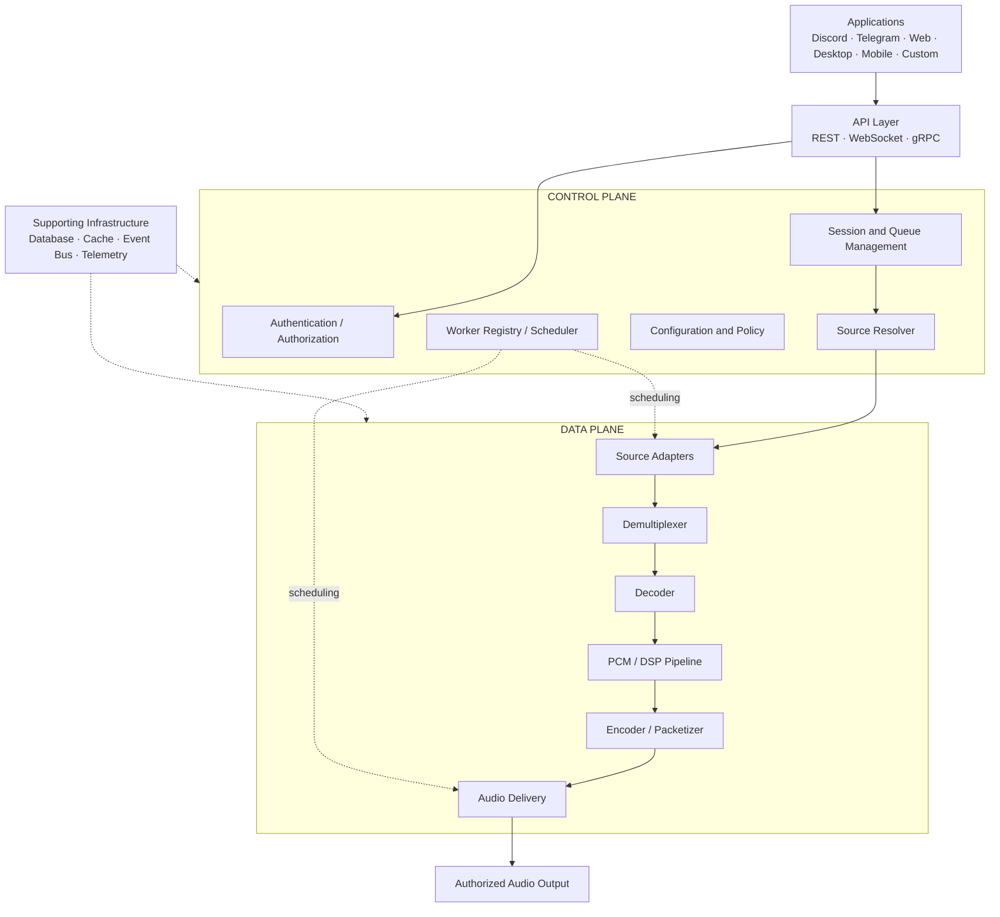
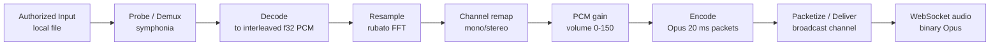

# NEXORA Architecture

High-level system design and data flow for NEXORA, a Rust-first, modular audio engine and service platform.

This document tracks the implemented structure plus the intended evolutionary path. For the product positioning and long-term vision, see `README.md`. For observed runtime behavior and invariants, see `docs/SYSTEM_DESIGN.md`.

## Scope

NEXORA is a from-scratch Rust alternative to hosted audio servers such as Lavalink. It provides media ingestion, decoding, audio processing, transcoding, session orchestration, and audio delivery through documented interfaces that applications can consume from different programming languages.

Target application ecosystems: Discord/Telegram bots, web applications, desktop and mobile applications, games, and custom backend services.

## 1. Evolutionary architecture

The target is a distributed system, but the first implementation does not create a network boundary for every module.

| Stage | Focus | Description |
|---|---|---|
| Stage 1 | Modular core | One deployable Rust application with well-separated crates and bounded internal interfaces. |
| Stage 2 | Service extraction | Extract components only when independent scaling, fault isolation, deployment, or ownership provides a measurable benefit. |
| Stage 3 | Distributed deployment | Add worker registration, scheduling, event distribution, and multi-node operations. |

This avoids paying microservice networking and operational costs before the workload requires them.

## 2. Control plane and data plane

The logical separation remains important even when both planes initially run in one process.

### Control plane

Responsible for:

- API authentication and authorization (Bearer token).
- Application configuration and policy.
- Session creation and lifecycle commands.
- Source selection and resolution requests.
- Worker discovery and scheduling in distributed mode.
- Quotas, policies, and administrative operations.

### Data plane

Responsible for:

- Source ingestion.
- Demultiplexing and decoding.
- PCM frame processing.
- DSP and resampling.
- Encoding and packetization.
- Buffering and audio delivery.

**Performance rule:** Audio frames should not be routed through the public API gateway or serialized as ordinary JSON messages. Keep the media path close to the processing and delivery workers.

### 2.1 Communication choices

| Communication | Intended use |
|---|---|
| HTTPS | Public REST API |
| WebSocket | Session and playback events; native audio delivery |
| gRPC | Typed internal RPC and selected streaming interfaces |
| NATS | Asynchronous service events in distributed deployments |
| HTTP health endpoints | Liveness and readiness |
| Prometheus / OTLP | Metrics and telemetry |

## 3. High-level logical architecture



## 4. Implemented crate and service structure

The Rust workspace is defined in the root `Cargo.toml`. Current members:

| Crate / service | Responsibility | Phase |
|---|---|---|
| `crates/nexora-error` | Structured errors, no secret leakage | Phase 1 |
| `crates/nexora-common` | IDs, service names, API version, timestamps | Phase 1 |
| `crates/nexora-audio-types` | `AudioFrame`, `AudioFormat`, `AudioCodec`, `FramePool` contract | Phase 1 |
| `crates/nexora-protocol` | Versioned DTOs, event envelope, command enum | Phase 1 |
| `crates/nexora-config` | Figment defaults + TOML + environment overrides | Phase 1 |
| `crates/nexora-telemetry` | tracing init, metric names | Phase 1 |
| `crates/nexora-service` | Service trait, health, shutdown | Phase 1 |
| `crates/nexora-audio-decode` | Symphonia decoder to interleaved f32 PCM | Phase 2 |
| `crates/nexora-audio-codec` | WAV writer, Opus packets, Ogg Opus writer | Phase 2 |
| `crates/nexora-audio-pipeline` | Resampling, clipping, bounded queue, channel remap, packet preparation | Phase 2 |
| `crates/nexora-source-api` | `AudioSource` trait, auth/track/resolution contracts | Phase 3 |
| `crates/nexora-source-framework` | Registry, ranking, timeout, cancellation, adapters | Phase 3 |
| `crates/nexora-session` | Session lifecycle, queue, playback control signals, event broadcast | Phase 4a |
| `crates/nexora-grpc` | Tonic server/client over `SessionManager` | Phase 4b |
| `crates/nexora-cluster` | Worker registry, capability filtering, weighted scheduler | Phase 5 |
| `crates/nexora-plugin-api` | Plugin manifest validation and sandbox policy | Phase 6 |
| `services/nexora-gateway` | Phase 1 skeleton binary | Phase 1 |
| `services/nexora-server` | Axum REST + WebSocket, `/api/v1` and `/v4` surfaces, gRPC listener | Phase 4a/4b |
| `services/nexora-audio-engine` | Standalone CLI: decode → resample → encode | Phase 2 |

### 4.1 Dependency direction

```
nexora-error -> nexora-common -> nexora-audio-types
                     |                 |
                     +-> nexora-protocol
                              |
nexora-config / nexora-telemetry
                     |
                nexora-service
                     |
             nexora-gateway
```

Audio crates (`nexora-audio-decode`, `nexora-audio-codec`, `nexora-audio-pipeline`) depend on the audio-types crate only. No cycles. Shared types do not depend on services.

## 5. Data flow

### 5.1 Audio processing pipeline



### 5.2 Stages

1. **Input validation** — validate source configuration and authorization context.
2. **Probing** — determine container, stream metadata, codec, and parameters via Symphonia.
3. **Decoding** — convert encoded packets to interleaved f32 PCM.
4. **Resampling** — convert sample rate when the output requires it (Rubato FFT).
5. **Channel remap** — normalize channel count by downmixing to mono then fanning out.
6. **PCM gain** — apply volume as PCM gain before encoding (clamped to -1.0..1.0).
7. **Encoding** — encode PCM to Opus 20 ms packets; write Ogg Opus container when applicable.
8. **Delivery** — send one Opus packet per 20 ms tick through a bounded broadcast channel; consumers that lag skip missed packets rather than blocking the producer.

### 5.3 Internal audio representation

| Type | Purpose |
|---|---|
| `AudioFormat` | `sample_rate: u32`, `channels: u16`, `codec: AudioCodec` |
| `AudioFrame` | `sequence`, `timestamp_ns`, `sample_rate`, `channels`, `samples: Vec<f32>` |
| `OpusFrame` | `sequence`, `timestamp_ms`, `duration_ms` (20 ms), `payload: Vec<u8>` |
| `FramePool` | Reusable buffer contract (`VecFramePool` implementation) |

### 5.4 Session data flow

```mermaid
flowchart TD
    C["Client"] -->|POST /api/v1/sessions| S["SessionManager.create"]
    C -->|POST /api/v1/sessions/{id}/play| P["play: resolve source"]
    P -->|ResolvedSource::LocalFile| R["run_playback task"]
    R -->|encode_file_packets| A["audio pipeline: decode→resample→encode"]
    A -->|OpusFrame| B["PlaybackRegistry broadcast"]
    B -->|subscribe| W["/ws/v1/sessions/{id}/audio<br/>binary Opus packets"]
    C -->|GET /ws/v1/sessions/{id}| E["EventEnvelope JSON text"]
    S -->|broadcast| E
    P -->|TrackStarted| E
    R -->|TrackEnded / TrackFailed| E
```

1. Client searches via `SourceRegistry` and gets a track id.
2. `POST /play` resolves the track id to a `ResolvedSource::LocalFile`. If the source cannot be resolved or is not a local file, return an error and emit `TrackFailed`; do not set `playing`.
3. The server reads current volume, asks the audio pipeline for 20 ms Opus packets, creates a per-session bounded broadcast channel, attaches a playback control receiver to the session, and spawns one pacing task.
4. The pacing task sends at most one packet per 20 ms tick, updates session position, counts streamed bytes, and reacts to pause/resume/seek/volume/stop. A volume change re-encodes with the new PCM gain at the current position.
5. On end-of-packets it emits `TrackEnded`, clears the current track, and removes the delivery channel.
6. The audio WebSocket sends one Opus packet per binary message in order. The event WebSocket remains text-only.

## 6. Potential service boundaries

These are logical components, not a requirement to create all of them as separate services in the first release.

| Component | Responsibility | Initial priority |
|---|---|---|
| `nexora-api` | Public API and request validation | P0 |
| `nexora-auth` | Application identity and permissions | P0 |
| `nexora-session` | Playback lifecycle and queues | P0 |
| `nexora-resolver` | Source discovery and resolution | P0 |
| `nexora-source` | Source adapter execution | P0 |
| `nexora-audio` | Decode, PCM processing, and encode orchestration | P0 |
| `nexora-delivery` | Audio output transport | P0 |
| `nexora-registry` | Worker discovery in distributed mode | P1 |
| `nexora-cluster` | Scheduling and cluster coordination | P1 |
| `nexora-plugin-host` | Sandboxed extension execution | P1 |
| `nexora-observability` | Metrics, logs, and traces | P1 |
| `nexora-admin` | Administrative interface | P2 |

P0 means required for the first useful implementation. P1 and P2 are later capabilities, not commitments that they already exist.

## 7. Security posture

- No secrets in code, config defaults, logs, or errors.
- No network listeners in the CLI binaries (gateway skeleton waits for Ctrl-C).
- No provider integrations, external media access, or open-proxy behavior.
- No unsafe Rust.
- Dependency versions are pinned in the workspace manifest and locked in `Cargo.lock`.
- Local media stays under the configured root; traversal, absolute paths, and parent components are rejected.
- Bearer-token authorization on every REST/WS route except `/health`, `/api/v1/info`, `/v4/info`.
- SSRF-safe URL validation for http(s) targets; private/loopback/link-local/localhost targets are rejected without DNS resolution.
- Bounded broadcast channels prevent a slow client from growing memory.
- Volume is clamped to 0..150; gain above 100 may clip and is documented as such.

## 8. Deferred to later phases

Full Lavalink client conformance and runtime metrics (Phase 4 remainder), SDKs (Phase 5), clustering (Phase 6), WASM plugin runtime (Phase 7), durable sessions, and production hardening (Phase 8).

## 9. Related documents

- `README.md` — product vision, long-term architecture, and proposed repository structure.
- `docs/SYSTEM_DESIGN.md` — observed runtime behavior, invariants, and the first working vertical slice.
- `docs/API.md` — native `/api/v1`, audio WebSocket, and `/v4` contracts.
- `docs/PROTOCOL.md` — REST + WebSocket endpoint specification.
- `docs/PROJECT_STATUS.md` — what is verified right now.
- `docs/LAVALINK_ANALYSIS.md` — Lavalink protocol reference and deliberate non-goals.
- `docs/adr/README.md` — architecture decision records.
